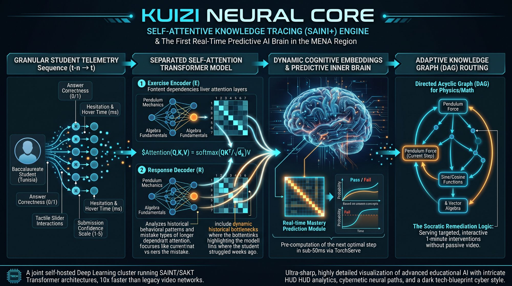

# Kuizi Neural Core

The Neural Core is the knowledge-tracing engine at the centre of Kuizi: it turns each student's micro-interactions into a per-concept prediction of success, and turns that prediction into the next best step.

To learn each idea step by step with runnable code, follow the [brain walkthrough](../brain/README.md) (T238), in English and Arabic.

## How it works, in four stages

1. **Granular telemetry.** Every answer (correct or not), hesitation and hover time, slider move in a simulation, and confidence rating (1–5) is sent as an event (T023–T026); the answer evaluation service decides right, wrong or partial (T221).
2. **Separated self-attention transformer (SAINT+).** An exercise encoder reads the sequence of items and concepts; a response decoder reads the answers, timings, hints and confidence. Separated attention lets the model weigh a mistake made weeks ago on a prerequisite (T040–T042). New students start from an IRT estimate after a 12-question placement test (T043).
3. **Real-time mastery prediction.** TorchServe returns the probability of failure per concept in under 50 ms; attention weights explain which past answers drive the prediction (T046, T048, T049).
4. **Knowledge-graph routing and Socratic remediation.** The router walks the prerequisite graph (a directed acyclic graph per subject) to choose the next item or a 1-minute remediation, pre-computed so the student never waits (T052, T053, T056, T070, T071).

## Traceability to the backlog

| Neural Core element | Tickets |
| --- | --- |
| Granular student telemetry: correctness, hesitation and hover time, tactile slider moves, confidence 1–5 | T023, T024, T025, T026, T221 |
| Separated self-attention transformer: exercise encoder and response decoder (SAINT+) | T238, T040, T041, T042, T239 |
| Cold start before enough history | T043 |
| Dynamic cognitive embeddings and real-time mastery prediction | T046, T048, T049 |
| Attention-based explanations of what weighs on a concept | T049, T177 |
| Pre-computation of the next optimal step in under 50 ms via TorchServe | T046, T056 |
| Adaptive knowledge-graph (DAG) routing for physics and maths | T032, T035, T052, T111 |
| Socratic remediation: targeted 1-minute interventions without passive video | T053, T070, T071, T179 |
| Self-hosted deep-learning cluster (SAINT/SAKT) and weekly retraining | T003, T045, T047 |
| Accommodation-aware tracing so assistive use is never read as weakness | T148 |
| Public claims on the infographic ("first in MENA", "10x faster") | T199 |

## Before using the infographic publicly

The image is a concept visual, not a specification. Fix these before external use:

- The engine is **SAINT+**; the image says "SAINI+".
- Several captions contain garbled text ("Fontent dependencies liver attention layers", "bottentinks", "dependratt attention", "HUD HUD").
- "First Real-Time Predictive AI Brain in the MENA Region" and "10x faster than legacy video networks" are marketing claims that need evidence before publication (T199).
- The formula should read `Attention(Q, K, V) = softmax(QKᵀ / √d_k) V` without the leading `$`.
