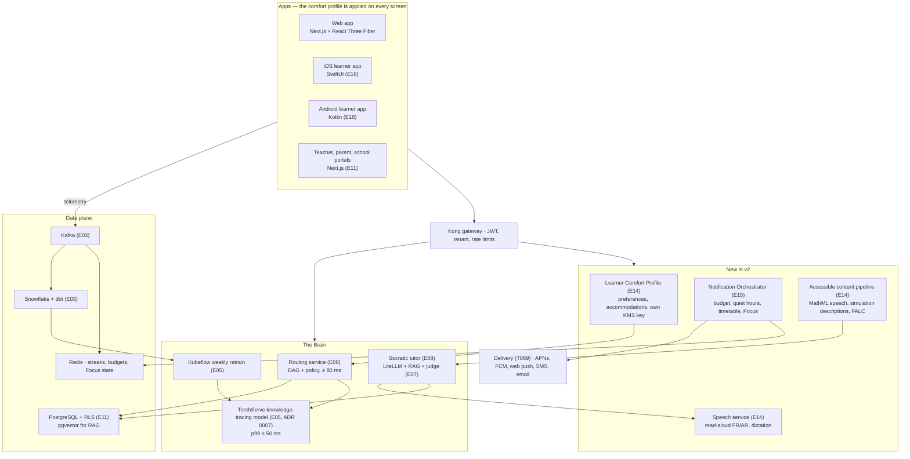

# Architecture overview

Kuizi has two equally weighted halves: **the Brain** (knowledge tracing, routing, tutor) and **the platform** (event-driven services, apps, data). Version 2 of the backlog adds four services and native apps without changing the critical path from telemetry to the router.

## Components and owners

| Component | Epic | Agent role | Key targets |
| --- | --- | --- | --- |
| AWS EKS, Terraform, ArgoCD, Kong, Datadog | E01 | Platform / DevOps | Staging from zero in under 60 minutes |
| Identity (Keycloak), consent, encryption, audit | E02 | Backend, Security | Pen-test with no High/Critical findings |
| Telemetry (Kafka, Redis, Snowflake, dbt, feature store) | E03 | Data Engineering | 50k events/s, warehouse lag under 5 minutes |
| Knowledge graph and item bank | E04, E13 | Product + Curriculum | At least 400 KCs and 6,000 items for Physics |
| Knowledge tracing (model chosen in ADR 0007: AKT proposed, DKT fallback), IRT cold start, retraining | E05 | ML Engineering | AUC ≥ 0.80, p99 ≤ 50 ms |
| Routing, remediation, spaced repetition, daily plan | E06 | Backend | Next step in ≤ 80 ms |
| LLM gateway, RAG, judge, prompt registry | E07 | LLM / Applied AI | No unjudged tutor output reaches a student |
| Socratic tutor UX, hint ladder, misconceptions | E08 | Frontend, LLM | First token under 1.2 s at p75 on 3G |
| Web app, simulations, offline, battles | E09 | Frontend | WCAG 2.2 AA, 2 GB RAM devices |
| Gamification | E10 | Backend | Rewards mastery gain, not volume |
| School, teacher and parent portals, billing | E11 | Backend, Frontend | Tenant isolation by RLS |
| Observability, testing, DR, launch | E12 | QA / SDET, Platform | RPO 15 min, RTO 1 h |
| Accessibility, comfort profile, speech | E14 | Accessibility, Frontend, Backend, ML | See requirements |
| Focus mode and Notification Orchestrator | E15 | Backend, Mobile | Zero sends in protected windows |
| Native apps and store compliance | E16 | Mobile | First-submission approval |
| Learner screens and Cyanotype design system | E17 | Frontend, Design | Screens 01–07 in FR and AR |
| Mock Bac, annales, grade estimate | E18 | Frontend, ML, LLM | Calibrated estimate with uncertainty band |
| Analytics, growth, go-to-market | E19 | Data, Growth, Backend | KPI dashboards before the pilot |
| Support, back-office, legal | E20 | Support, Backend, Legal | Help center and legal documents before the pilot |

## Decisions

Architecture decisions are recorded in [`decisions/`](decisions/). The Neural Core engine is described in [`neural-core.md`](neural-core.md). Requirements for accessibility, Focus and notifications, including data protection and model fairness, are in [`../requirements/accessibility-focus-notifications.md`](../requirements/accessibility-focus-notifications.md).
