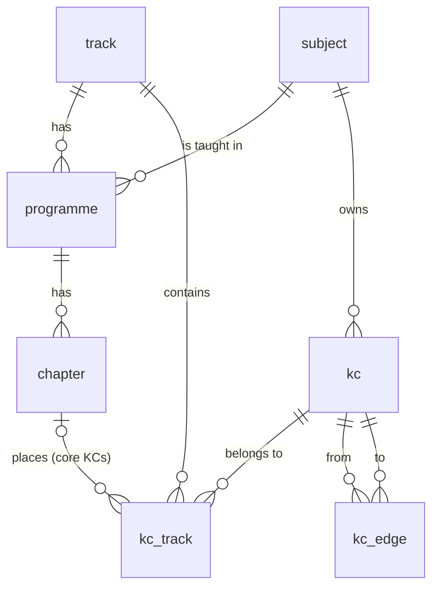

# Knowledge-component graph

The concept graph of the Tunisian Bac (T032, Jira KK-52). It says which knowledge components (KCs) each programme track contains, in which chapter of that track's official programme, and which KC must be known before which. The routing service walks it to send a struggling student back to the weak prerequisite (T052, T053), and the tutor RAG uses it to tag and filter textbook passages (T039, T061).

Code, seed and tests are in [`curriculum/graph/`](../../curriculum/graph/README.md) (ADR 0008).

**Status.** The store, the loader and the export are complete. The Physics seed is a **starter**: every chapter of the 4e année programme of three sections, a few KCs per chapter, everything marked *to review*. T035 completes it (about 400 KCs, at least 600 edges) and a Tunisian physics teacher signs it off (ADR 0005). Nothing reaches students before that.

## The model



| Table | Holds | Key rules |
| --- | --- | --- |
| `subject` | `physics`, `maths`, later `sciences`, `technique`, `eco_gestion` (T033) | FR and AR names |
| `track` | A Bac section in one school year: `math-4`, `sexp-4`, `tech-4` | id is `<section>-<year>` |
| `programme` | The official programme of one subject in one track | `source_ref` says where it was read |
| `chapter` | Chapters of a programme, numbered as in that track | theme and title in FR and AR, `source_ref` |
| `kc` | A knowledge component | stable `id`; `path` (ltree) in the subject taxonomy; FR and AR names; optional description; `difficulty_prior`; `status` |
| `kc_track` | Which tracks a KC belongs to | one row per (track, KC): `scope`, track-specific `chapter_no` and `exam_weight` |
| `kc_edge` | Typed edges between KCs | `prerequisite`, `sub_concept`, `related`; no self-loop; unique |
| `kc_graph_lock` | One row per acyclic edge type | serialises edge writers (see below) |

**One KC, several tracks.** The same KC (for example `physics.waves.mechanical`) is chapter 7 for Mathématiques and Sciences expérimentales and chapter 9 for Sciences techniques. The chapter and the exam weight therefore live on the membership (`kc_track`), not on the KC. Composite foreign keys keep it consistent: a core membership must point at a chapter of *that* track's programme in *the KC's* subject.

**Scope of a membership.**

- `core`: in the track's programme, at that chapter; examined in that track.
- `prerequisite`: needed by a core KC but taught in an earlier year or in another subject (for example `physics.mech.newton2`, taught before 4e année, or `maths.analysis.ode1`). It has no chapter; `source_ref` says where it is taught. Routing may send a student there; the daily plan does not count it as exam coverage.

**Prerequisite closure.** A track holds every prerequisite of its KCs, directly or transitively. `kuizi-kc-graph validate` refuses a seed that breaks this, so routing inside one track never loses a link.

**Edges.**

| Type | Meaning | Rules |
| --- | --- | --- |
| `prerequisite` | `from` must be known before `to` | acyclic |
| `sub_concept` | `from` contains `to`; mastery of `from` aggregates its sub-concepts | acyclic |
| `related` | symmetric link, for example the electrical–mechanical analogies | stored once in either direction |

The ltree `path` and the `sub_concept` edges are different things. The path is the browsing taxonomy (one parent, cheap subtree queries such as `path <@ 'physics.elec.rlc'`). `sub_concept` is pedagogical composition and can give a KC several parents. Most of the time a sub-concept's path extends its parent's.

**Columns with a meaning to agree on.**

- `kc.difficulty_prior`: expected IRT difficulty *b* (logit scale, about −3 easy to +3 hard) of a typical item on the KC, before calibration. `NULL` until T043 and T044 provide it.
- `kc_track.exam_weight`: share (0 to 1) of the track's Bac points in that subject that past papers attribute to the KC (a question tagged with several KCs splits its points). It needs `exam_weight_source`. The weights of one subject in one track add up to at most 1. `NULL` until T035 measures them.
- `kc.status` and `kc_edge.status`: `to_review` until a Tunisian subject teacher has checked them, then `reviewed`. A KC no longer used becomes `retired` (it stays for history and is not exported); retire, never delete, a KC that items or mastery records use.

## Cycles and concurrent writes

A `BEFORE INSERT OR UPDATE` trigger on `kc_edge` (`kc_edge_acyclic`) rejects a `prerequisite` or `sub_concept` edge if a path of the same type already leads from its target back to its source. The search is a recursive CTE that visits each KC once. On rejection a second query names the cycle:

```text
ERROR:  prerequisite edge physics.t.c -> physics.t.a would create a cycle
DETAIL: Cycle: physics.t.c -> physics.t.a -> physics.t.b -> physics.t.c
HINT:   prerequisite and sub_concept edges must form a directed acyclic graph; remove one edge of the cycle.
```

The error is SQLSTATE `23514` (check violation) with constraint name `kc_edge_acyclic`, so clients handle it like any constraint. A self-loop is rejected by the check constraint `kc_edge_no_self_loop`.

Two transactions could each add half of a cycle (`a → b` and `b → a`) without seeing the other's uncommitted row. Before searching, the trigger updates its edge type's row in `kc_graph_lock`, so writers of one edge type take turns:

- **READ COMMITTED** (the default): the second writer waits for the first to commit. The trigger function is volatile, so its search takes a fresh snapshot after the wait and sees the new edge; the second insert is rejected as a cycle.
- **REPEATABLE READ or SERIALIZABLE**: the second writer gets SQLSTATE `40001` (serialization failure) and must retry; the retry sees the edge.

Both cases are tested (`tests/test_db.py`). Graph authoring is rare, so taking turns per edge type costs nothing noticeable.

## Naming rules for KC ids

- Form: `subject.domain[.topic].concept`, lowercase ASCII letters, digits and `_`, at least two labels, at most 120 characters. Labels are short English identifiers; the names carry French and Arabic.
- The first label is the subject id (enforced by the database).
- Physics domains: `found` (shared foundations such as periodic and sinusoidal quantities), `elec`, `mech`, `waves`, `optics`, `atom`, `nuclear`. Maths: `geometry`, `analysis`, and the domains T111 adds.
- A chapter-level KC (`physics.elec.rc`) groups its sub-concepts, whose ids extend it (`physics.elec.rc.time_constant`). A KC that is not part of one parent keeps a shorter id (`physics.waves.reflection_refraction`).
- Never put a track or a chapter number in an id: KCs are shared by tracks, and chapters differ between tracks.
- **An id never changes** once items (T036), mastery records or models use it, and a retired id is never reused. The `path` can move in the taxonomy; the id stays. The loader sets the path to the id unless the seed gives another.
- Prerequisite edges join the most specific KCs that carry the dependency. Chapter-level KCs connect to their sub-concepts through `sub_concept` edges.
- One KC is one idea or skill an item can test and a student can master. T035 refines the starter roughly tenfold.

## How to add or change a KC

Until the authoring tool (T034) exists, the graph is edited as YAML and reviewed in a pull request.

1. Pick an id with the rules above and check that no KC already covers the idea (`grep -n "id:" curriculum/graph/seed/*.yaml`).
2. Add an entry to the seed: `name` (fr and ar), `parents`, `requires`, and either `chapters` (track → chapter number) or `prerequisite_in` with `source_ref`. The format is at the top of [`physics_starter.yaml`](../../curriculum/graph/seed/physics_starter.yaml).
3. Run `uv run kuizi-kc-graph validate seed/physics_starter.yaml` in `curriculum/graph/`. It lists every problem: unknown references, missing Arabic, cycles, a prerequisite missing from a track, unknown chapters, unsourced exam weights.
4. Run `make graph-load`, `make graph-export` and `make graph-test`.
5. Open a pull request. New content stays `to_review`; only a Tunisian subject teacher's review turns it `reviewed`. Until T034 records reviews, the pull request records who reviewed what.

## The JSON export

`kuizi-kc-graph export` reads PostgreSQL and writes the graph of one or more tracks. The format is [`export.schema.json`](../../curriculum/graph/export.schema.json) (JSON Schema 2020-12, `format_version` 1.0). Every export is checked against it, plus the references a schema cannot check (every KC id named exists, the topological order respects the prerequisites, the hash matches).

| Field | Content |
| --- | --- |
| `format`, `format_version`, `generated_at` | identification |
| `graph_hash` | sha256 of everything except `generated_at`: an unchanged graph keeps its hash |
| `filter` | the tracks asked for (`null` = all) and `reviewed_only` |
| `subjects` | id and FR/AR names |
| `tracks[]` | id, section, year, names, `programmes[]` (subject, title, source, `chapters[]` with number, theme, title, source) and `topological_order` (every KC of the track, prerequisites first, ties by id) |
| `kcs[]` | id, subject, path, names, description, `difficulty_prior`, `review_status`, `depth`, `prerequisites`, `dependents`, `parents`, `children`, `related`, `memberships[]` (track, scope, chapter, exam weight and its source, source_ref) |
| `edges[]` | from, to, type, review status |

One KC of a `--track sexp-4` export:

```json
{
  "id": "physics.elec.rc.time_constant",
  "subject": "physics",
  "path": "physics.elec.rc.time_constant",
  "name": { "fr": "Constante de temps τ = RC", "ar": "ثابت الزمن τ = RC" },
  "description": null,
  "difficulty_prior": null,
  "review_status": "to_review",
  "depth": 4,
  "prerequisites": ["physics.elec.rc.ode"],
  "dependents": [],
  "parents": ["physics.elec.rc"],
  "children": [],
  "related": ["physics.elec.rl.time_constant"],
  "memberships": [
    { "track": "sexp-4", "scope": "core", "chapter": 1, "exam_weight": null,
      "exam_weight_source": null, "source_ref": null }
  ]
}
```

**Anything students see must come from `--reviewed-only`**, which keeps only reviewed KCs and edges. With the starter seed that export is empty, on purpose.

### How the routing service uses it (T052, T053, T057, T058)

- Load the export of the student's track at start-up and keep it in memory. Reload when `graph_hash` changes; T034 adds published versions on top of this.
- Remediation (T053): from a struggling KC, follow `prerequisites` (at most two levels) and pick the deepest unmastered one using `depth`, as `weakest_prerequisite` does in [`ml/kuizi_brain/graph.py`](../../ml/kuizi_brain/graph.py). Closure guarantees the walk stays inside the track.
- `topological_order` gives a valid learning or diagnostic order; `children` aggregates mastery of a chapter-level KC from its sub-concepts.
- `memberships[].scope` keeps prerequisite-scope KCs as remediation targets only; `exam_weight` (once T035 sets it) feeds the daily plan (T057); `chapter` supports a teacher pinning a chapter (T058).

### How the tutor RAG uses it (T039, T061)

- Chunk tagging (T039): each textbook chunk gets KC ids, the track and the chapter number; chapter titles come from `tracks[].programmes[].chapters`.
- Retrieval filter (T061): start from the item's KC tags, then widen to the subtree of their `path` (for example every chunk under `physics.elec.rlc`), and optionally to `related` KCs.
- `name.fr` and `name.ar` give the bilingual terms for query expansion and prompts; chapter number and title give the citation, the chunk gives the page.

## The starter Physics seed

[`curriculum/graph/seed/physics_starter.yaml`](../../curriculum/graph/seed/physics_starter.yaml): **70 KCs** and **132 edges** (87 prerequisite, 40 sub_concept, 5 related).

| Track | KCs | Core | Prerequisite scope | Chapters |
| --- | --- | --- | --- | --- |
| `math-4` (4e Mathématiques) | 63 | 47 | 16 | 11 |
| `sexp-4` (4e Sciences expérimentales) | 61 | 46 | 15 | 11 |
| `tech-4` (4e Sciences techniques) | 53 | 38 | 15 | 9 |

The 53 programme KCs are 12 chapter-level KCs with 2 to 5 sub-concepts each, plus `physics.waves.reflection_refraction`. The 17 prerequisite KCs are 6 in mathematics and 11 in physics from earlier years.

Chapters by track, as numbered in each programme:

| Theme | Chapter | math-4 | sexp-4 | tech-4 |
| --- | --- | --- | --- | --- |
| Évolution de systèmes | Le condensateur ; le dipôle RC | 1 | 1 | 1 |
| | La bobine ; le dipôle RL | 2 | 2 | 2 |
| | Oscillations électriques libres | 3 | 3 | 3 |
| | Oscillations électriques forcées en régime sinusoïdal | 4 | 4 | 4 |
| | Oscillations libres d'un pendule élastique | 5 | 5 | 5 |
| | Oscillations forcées d'un pendule élastique en régime sinusoïdal | 6 | 6 | 6 |
| Ondes | Ondes mécaniques progressives | 7 | 7 | 9 |
| | Nature ondulatoire de la lumière | 8 (adds reflection and refraction of mechanical waves) | 8 | — |
| Physique atomique et nucléaire | Spectre atomique | 9 | 9 | — |
| | Le noyau atomique | 10 | 10 | — |
| | Réactions nucléaires | 11 | 11 | — |
| Filtres électriques | Les filtres électriques | — | — | 7 |
| | Exemples de filtres électriques | — | — | 8 |

The 12 concepts of the brain walkthrough are kept:

| Brain id (`ml/kuizi_brain/graph.py`) | KC id |
| --- | --- |
| `vect` | `maths.geometry.vectors` |
| `deriv` | `maths.analysis.derivative` |
| `eqdiff` | `maths.analysis.ode1` |
| `cinem` | `physics.mech.kinematics` |
| `newton` | `physics.mech.newton2` |
| `energie` | `physics.mech.energy` |
| `osc_meca` | `physics.mech.oscillations.free` |
| `rc` | `physics.elec.rc` |
| `rl` | `physics.elec.rl` |
| `rlc` | `physics.elec.rlc.free` |
| `forcees` | `physics.elec.rlc.forced` and `physics.mech.oscillations.forced` |
| `ondes` | `physics.waves.mechanical` |

One brain edge was not kept: `osc_meca → ondes`. The textbooks list periodic and sinusoidal quantities as the prerequisites of the waves chapter, not the elastic pendulum, so the seed uses `physics.found.sinusoidal` instead. The teacher review should confirm.

### Placeholders, to be completed in T035

- **Exam weights**: none is set. No source gives per-concept weights; T035 measures them on ten years of Bac papers.
- **Difficulty priors**: none is set (T043, T044).
- **Granularity**: a few KCs per chapter; T035 reaches about 400.
- **Earlier-year prerequisites**: their year and chapter are not checked yet (each `source_ref` says so).
- **Arabic names**: Kuizi's own wording, following the terms already used in `ml/kuizi_brain/graph.py`; the teacher checks them with the French.
- **Review**: every KC and edge is `to_review`.

### Sources and rights

| Source | Used for | Rights |
| --- | --- | --- |
| CNP textbook *Physique, 4ème année de l'enseignement secondaire, Sciences expérimentales* (dir. A. Baatout; updated and adapted edition; Centre National Pédagogique). Copy read at <https://sigmaths.net/manuels/ph/ph_4sc.pdf> | Foreword (follows the official programme published in September 2009), table of contents, each chapter's objectives and prerequisites page | © CNP, all rights reserved. We record chapter titles and page numbers only; KC names are our own wording; no text, figure or exercise is reproduced |
| CNP textbook *Physique, 4ème année de l'enseignement secondaire, Mathématiques* (dir. A. Baatout). Copy read at <https://sigmaths.net/manuels/ph/ph_4M.pdf> | Table of contents; objectives of chapters 7, 8 and 9 | As above |
| CNP textbook *Physique, 4ème année de l'enseignement secondaire, Sciences techniques* (dir. A. Baatout). Copy read at <https://sigmaths.net/manuels/ph/ph_4t.pdf> | Foreword (official programme of September 2009), table of contents, objectives of chapters 7 and 8 | As above |
| Kuizi brain walkthrough, [`ml/kuizi_brain/graph.py`](../../ml/kuizi_brain/graph.py) | The 12 starting concepts and their French and Arabic names | Kuizi |

The official programme texts of the Ministry of Education were not found online; the textbooks state that they follow them. sigmaths.net is a third-party site hosting the CNP books. Licensing of the textbooks themselves is confirmed with the CNP in T039.

Findings worth checking with a teacher:

- The Mathématiques textbook's foreword cites the Sciences expérimentales programme, but its chapter 8 differs: its running title is "Interactions onde-matière" and it adds reflection and refraction of mechanical waves (hence `physics.waves.reflection_refraction`, in `math-4` only).
- Sciences techniques has no light, atomic or nuclear physics; it has two chapters on electrical filters instead.
- The programmes date from 2009. Whether a reduced programme (*allègement*) applies to the coming Bac sessions could not be confirmed from an official source.

## Commands and tests

```bash
make up                 # the local stack (PostgreSQL 16 with pgvector; ltree ships with it)
make graph-setup        # uv sync in curriculum/graph
make graph-load         # migrate schema "curriculum", load the starter seed
make graph-export       # curriculum/graph/out/kc_graph.json
make graph-test         # pytest
```

The tests cover the graph algorithms, the seed (valid, no cycles, every chapter covered, bilingual, no invented numbers), the export (schema, per-track content, ordering, hash, reviewed-only) and, against PostgreSQL in throwaway schemas, the migration, shared tracks, membership rules, cycle and self-loop rejection, concurrent writers, the load and read-back round trip and the command line. Database tests skip when PostgreSQL is not reachable, unless `KUIZI_REQUIRE_POSTGRES=1`.

## What comes next

- T033 makes `subject` and `track` first-class in items, routing, mastery and telemetry; the tables here already carry both.
- T036 tags items with these KC ids.
- T034 adds the web editor, graph versions and the second-reviewer publish step.
- T035 completes the Physics graph and gets the pedagogical sign-off; T111, T114, T117 and T120 add the other subjects on the same store.
- The cloud move (T240) runs the same migration on Aurora PostgreSQL, which supports ltree.
