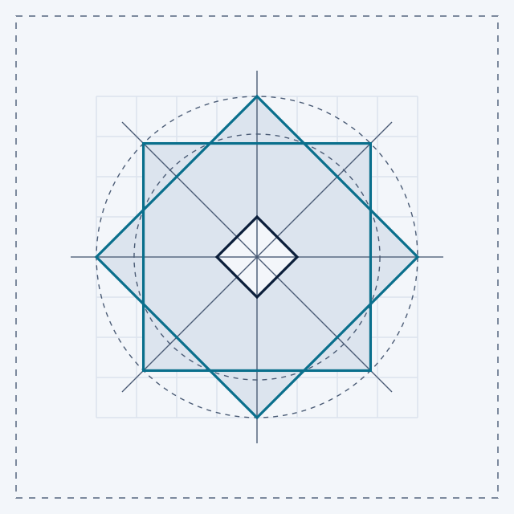
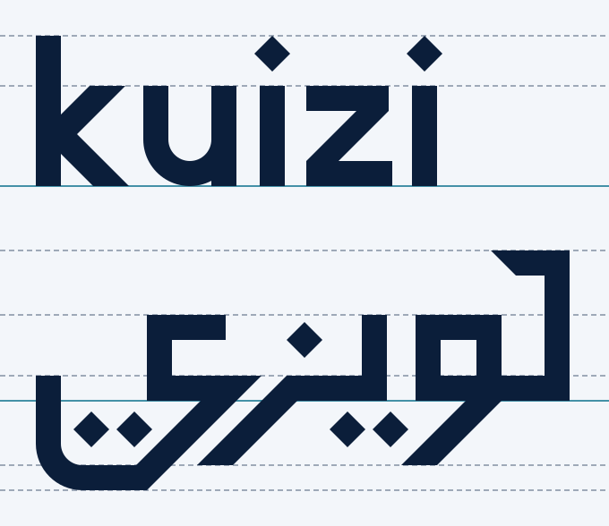

# Kuizi brand guide

> **Status: DRAFT (T231).** This guide becomes final only when the two reviews in [`brand-reviews.md`](brand-reviews.md) are done: the Arabic logotype review by a native Arabic type designer (acceptance criterion 2) and the trademark check of the name and the mark (acceptance criterion 3). Until then, the assets can be used for internal work (design system T174, prototypes), but nothing goes public: no marketing site (T193), no store listing (T197), no printed material.

The brand turns the [Cyanotype design system](design-system.md) into a recognisable identity. It is used by the design system in code (T174), the marketing site (T193) and the store listings (T197). Source files are in [`brand/`](../../brand/README.md); every PNG is rendered from [`brand/export.json`](../../brand/export.json).

## 1. The idea

**Najma and nuqta.** The mark is the eight-point star (النجمة, *najma*) seen on Tunisian zellige tiles, studded doors and jewellery, drawn the way an engineer would draw it: two squares on one circle, with every edge at 0°, 45° or 90°. At its centre sits a rhombus, the *nuqta* (النقطة). In Arabic calligraphy, the rhombic dot left by the reed pen is the unit that sets the proportions of every letter. In Kuizi, it stands for the student's current concept: the node the whole map is built around. The same rhombus dots the *i*'s of **kuizi** and the letters of **كويزي**, so the mark and both names are built from one unit.

**What it says.** Eight points mean eight directions: from any concept there is a way forward, and Kuizi finds the shortest one to the grade the student aims for. The style is that of a blueprint, precise and calm, never loud.

**Why a rhombus and not a circle.** An eight-point star with a circle at its centre is ۞, the Quranic *rub el hizb* marker. Kuizi is a secular learning product, so its counter is a rhombus to avoid that reading. The Arabic type review checks this too ([`brand-reviews.md`](brand-reviews.md)).

## 2. The name

| | Latin | Arabic |
| --- | --- | --- |
| Name in running text | **Kuizi** (capital K) | **كويزي** |
| Logotype | **kuizi** (lowercase, drawn) | **كويزي** (drawn) |
| Never | KUIZI in running text, Kuizzi, Quizi, Kwizi | كويز, كيوزي, قويزي |

The Arabic spelling «كويزي» is the one already used throughout the repository (brain notebooks, glossary, status page). It reads */kwīzī/*, like the Latin name. The product owner confirms it as part of acceptance criterion 2.

## 3. Files

| Need | File in `brand/` |
| --- | --- |
| Mark on light / dark / one colour | `mark/kuizi-star.svg`, `mark/kuizi-star-dark.svg`, `mark/kuizi-star-mono.svg` |
| Mark at 24 px and below | `mark/kuizi-star-micro.svg` |
| Lockups (mark + name) | `logo/kuizi-lockup-{latin,arabic,bilingual}-{light,dark,mono}.svg` |
| Logotypes alone | `logo/kuizi-wordmark-latin.svg`, `logo/kuizi-wordmark-arabic.svg` |
| App icons | `app-icon/ios/`, `app-icon/android/`, `app-icon/web/` (section 11) |
| Social and store images | `social/og-image.svg`, `social/play-feature-graphic.svg` |
| Construction diagrams | `mark/kuizi-star-construction.svg`, `logo/kuizi-wordmarks-construction.svg` |

The `-mono` files and the logotypes use `currentColor`. They render in night on their own; when inlined, set the CSS `color` property to change it.

## 4. The star mark

| Element | Construction (units of the 100 × 100 canvas, centre 50, 50) |
| --- | --- |
| Circle | All 8 points lie on the circle R = 50 |
| Square B (on its point) | Vertices N, E, S, W: (50, 0), (100, 50), (50, 100), (0, 50); diagonal 100 |
| Square A (upright) | Side 70.711 (= 100 / √2), corners at (14.645, 14.645) to (85.355, 85.355) |
| Star outline | Union of A and B: 16 vertices, 8 points of 90°, 8 re-entrant corners (225° inside) on the circle r = 38.268 |
| Edges | All 16 edges lie on the sides of the two squares, 35.355 from the centre, so an inset star is a scaled copy of the mark (useful for outline badges) |
| Counter (nuqta) | Rhombus = square B at 1/4 scale: half-diagonal 12.5, vertices (50, 37.5), (62.5, 50), (50, 62.5), (37.5, 50) |
| Micro counter | Rhombus at 1/3 scale (half-diagonal 16.667), for 24 px and below only |
| Angles | Only 0°, 45° and 90°. The star always stands on a point (a point at the top). |

**Star mark and product badges.** The design system's "eight-point star badges" (achievements, progress) reuse this geometry but must never be mistaken for the logo: badges are **outlined** (stroke 1/12 of the badge size, inset star from the rule above) and carry an icon or number inside. The solid star with the rhombus counter is reserved for the brand.

## 5. Logotypes

### Shared construction

| Rule | Value (logotype units) |
| --- | --- |
| Stroke | 14, monoline |
| Ascender (k, kaf, i dots) | y = 0 |
| Latin x-height | y = 28 (x-height 56) |
| Arabic tooth line (heads, teeth) | y = 36 (Arabic bodies sit a little lower than Latin lowercase, as in balanced bilingual pairings) |
| Baseline | y = 84; the Arabic baseline band is y = 70–84 |
| Arabic tails / ya bowl | y = 120 / y = 134 |
| Diagonals | 45° only, horizontal width 20 (perpendicular 14.1); the z diagonal is 18 wide (optical correction) |
| Curves | Circular arcs, outer radius 26, inner radius 12 (Latin u, Arabic ya bowl) |
| Dots | Rhombus, half-diagonal 10: the nuqta, side ≈ stroke, as in calligraphy |

### Latin: **kuizi**

Lowercase, so the name reads as friendly and the two rhombus dots stay visible. Glyphs (x range): k 0–52, u 60–112, i 125–139, z 151–199, i 210–224. The k has 45° arm and leg, the u a round bowl, the z a 45° diagonal. The letters are spaced by eye: 8 between diagonal and stem, 11–13 between straight sides.

### Arabic: **كويزي**

**Choice: geometric Kufi.** The letters follow the familiar naskh structure, so Tunisian teenagers read them at a glance, built on the star's 0/45/90° grid with Kufic square heads and horizontal baseline. Strict square Kufic was rejected because it is decorative and hard to read at small sizes. The native type designer review confirms or corrects this choice.

The word reads right to left in three units, because waw and zay never join to the following letter:

| Unit (reading order) | Letter | Form | How it is drawn |
| --- | --- | --- | --- |
| 1 | ك kaf | initial | Stem from the ascender to the baseline; head bar leaning left over the waw (the kaf's oblique stroke, drawn level with a 45° chamfer); joins left through the baseline |
| 1 | و waw | final | Square head 48 × 48 with a 20 × 20 counter, on the baseline; 45° tail leaving under the right half of the head, down-left to y 120 |
| 2 | ي ya | initial | Tooth up to the tooth line; two rhombus dots below it; joins left |
| 2 | ز zay | final | 45° tail leaving the end of the baseline, down-left to y 120 (the ra shape); one rhombus dot above |
| 3 | ي ya | isolated | Head open to the right above the baseline, 45° side down into a bowl to y 134, rounded corner, upturn on the left; two dots inside the bowl |

Spacing between units: the waw tail clears the ya dots with a constant 11-unit gap (parallel 45° edges); the zay tail runs parallel to the side of the final ya, 10 units apart. Overall size: 298 × 134 units.

**Never** set either name in a font and call it the logo, never mirror a logotype, never stretch it or change its letter spacing.

## 6. Lockups and when to use each

| Lockup | Layout | Use |
| --- | --- | --- |
| Latin | Star, gap 32, **kuizi**; logotype centred on the star's axis | French interface (app header, emails), French documents |
| Arabic | **كويزي**, gap 32, star on the right (Arabic starts on the right) | Arabic interface, Arabic documents |
| Bilingual | **كويزي**, star, **kuizi**: both names start at the star and read outwards | Marketing site header and footer, store images, social, documents for both audiences |
| Star alone | | App icon, favicon, avatars, splash screen, small spaces |

The interface switches between the Latin and Arabic lockups with the interface language. The bilingual lockup never mirrors: it is already symmetric in reading. Stacked lockups (star above the name) are not part of T231; ask for them if a layout needs one.

## 7. Clear space and minimum sizes

**Clear space:** x = 1/4 of the star's height (the width of the rhombus counter). Keep x free on every side of the mark or lockup, measured from the outermost shape (Arabic tails, i dots). Keep 2x from other logos (schools, ministry, partners).

| Asset | Smallest on screen | Smallest in print |
| --- | --- | --- |
| Star mark (regular counter) | 24 px | 6 mm |
| Star mark, micro counter | 16 px | 4 mm |
| Latin lockup | star 24 px high (lockup 86 px wide) | star 7 mm |
| Arabic lockup | star 32 px high (lockup 138 px wide) | star 9 mm |
| Bilingual lockup | star 32 px high (lockup 221 px wide) | star 9 mm |
| Logotype alone | Latin 20 px ascender-to-baseline; Arabic 24 px kaf-to-baseline | 6 mm / 7 mm |

## 8. Colour

The brand uses Cyanotype tokens only. Ratios are WCAG 2.2 relative-luminance contrast, computed from the token hex values.

| Foreground | Background | Ratio | Verdict |
| --- | --- | --- | --- |
| night `#0B1E3A` (logotype) | tracing-paper `#F3F6FA` | 15.4:1 | ✅ light version |
| night | white | 16.7:1 | ✅ |
| cyan `#0A6F8C` (star) | tracing-paper | 5.3:1 | ✅ light version |
| cyan | white | 5.7:1 | ✅ |
| tracing-paper (logotype) | night | 15.4:1 | ✅ dark version |
| cyan-light `#4FD1F0` (star) | night | 9.3:1 | ✅ dark version |
| white (mono) | cyan | 5.7:1 | ✅ one-colour reversed on cyan (buttons, merchandise) |
| cyan | night | 2.9:1 | ❌ never: below 3:1 |
| cyan-light | tracing-paper | 1.7:1 | ❌ never |
| amber `#F5A524` | tracing-paper | 1.9:1 | ❌ never in the logo |

Logotypes are exempt from WCAG contrast rules (1.4.3, "logotypes"), but Kuizi holds them to at least 3:1 anyway (WCAG 1.4.11 non-text contrast), and the logotype to 4.5:1.

**Colour rules.**
- Light backgrounds (tracing-paper, white): light version. Night backgrounds: dark version. Anything else (photos, cyan, mastery tones): one-colour version in night or white, whichever reaches 4.5:1, on a calm area.
- The logo never carries a status. Coral, mint and amber mean risk, mastery and the current step in the product, so they never colour the logo.
- No gradients, shadows, glows or transparency on the logo.

## 9. Right to left and mirroring

| Never mirrors | Mirrors (follows the reading direction) |
| --- | --- |
| The star (always a point at the top; never rotated) | The logo's place in a layout: start edge, so top-left in French and top-right in Arabic (CSS logical properties) |
| Both logotypes, every lockup, the bilingual lockup | The choice of lockup: Latin in French, Arabic in Arabic |
| App icons, favicons, social images | Directional illustration: paths, progress, arrows, "next" chevrons, the Bac countdown ruler |
| Digits, formulas, units, graphs and axes, circuit diagrams, maps | Composition of illustrations that imply reading order |
| Clocks, logos of others, text inside images, a hand writing (redraw instead of flipping a right-handed writer) | |

The Arabic lockup is its own artwork, never a flipped Latin lockup.

## 10. Incorrect uses

Do not:
1. Recolour outside the tokens, or use cyan on night or cyan-light on light backgrounds.
2. Stretch, skew, rotate (even by 45°: the rhombus would turn into a square) or outline the logo.
3. Replace the rhombus counter with a circle, a square or a letter.
4. Add shadows, glows, gradients, bevels, textures or a "glass" effect.
5. Retype "kuizi" or «كويزي» in any font, or capitalise the logotype.
6. Mirror a logotype or reorder the bilingual lockup.
7. Put the logo on a busy photo or on a mid-tone that fails 3:1.
8. Animate the star with spins or flashes. One gentle draw-in on the splash screen is allowed, and it is skipped when `prefers-reduced-motion` is set.
9. Use the solid star as a status icon, bullet or rating.
10. Squeeze the clear space or go below the minimum sizes.

## 11. App icons

| Platform | Source | Canvas | Content |
| --- | --- | --- | --- |
| iOS default | `app-icon/ios/kuizi-ios-default.svg` | 1024 px, opaque, square (iOS applies the mask) | Night background, cyan-light star R 320 (62.5 %) |
| iOS dark (18+) | `kuizi-ios-dark.svg` | 1024 px, transparent | Cyan-light star; the system adds the dark background |
| iOS tinted (18+) | `kuizi-ios-tinted.svg` | 1024 px | White star on black; the system applies the tint |
| iOS 26 Icon Composer | dark file as foreground layer, night as background layer | | Check the "clear" look keeps the star legible |
| Android adaptive | `app-icon/android/kuizi-adaptive-{background,foreground,monochrome}.svg` | 108 dp | Star R 24 dp (48 dp wide), inside the 66 dp safe zone; visible area 72 dp |
| Android legacy | `kuizi-legacy-square.svg`, `kuizi-legacy-round.svg` | 48 dp | Night tile or disc, star 61 % of the tile |
| Google Play | iOS default master | 512 px | Play applies the mask |
| Web | `app-icon/web/favicon.svg` (32, micro counter), `icon-any.svg`, `icon-maskable.svg` (star inside the 40 % safe circle) | | |

Icons never contain text, badges or seasonal decorations. Every size is listed in [`brand/export.json`](../../brand/export.json).

## 12. Typography pairing

| Use | Latin | Arabic |
| --- | --- | --- |
| Titles | Unbounded 700 / 800 | IBM Plex Sans Arabic 700 (Unbounded has no Arabic) |
| Text | IBM Plex Sans 400–700 | IBM Plex Sans Arabic 400–700 |
| Labels, data, IDs | IBM Plex Mono 500 | IBM Plex Mono for codes and IDs; labels in IBM Plex Sans Arabic 500 |
| Comfort profile | Lexend, Atkinson Hyperlegible | IBM Plex Sans Arabic at the comfort size and spacing (an Arabic reading-aid font is still to be chosen in T140) |

The logotypes echo these faces: monoline and wide like Unbounded, with straight, engineered terminals like Plex. Rules: never add letter spacing to Arabic (it breaks the joins), never slant Arabic (there is no true italic), give Arabic a line height of at least 1.6, and start bilingual text at the same size, then check visually.

## 13. Illustration style

**Look: a cyanotype print.** Either white and cyan-light linework on night (a sun print), or night and cyan linework on tracing-paper (a blueprint).
- Line weight 2 px at 1× for main lines and 1 px for construction lines. Dimension lines, arrows with ticks and construction circles are the decorative grammar.
- Flat fills from the tokens only: no gradients, no drop shadows, no photographic textures.
- At most one amber accent per illustration, always for "you are here / the current step", and always paired with a shape (a ring, a marker), never colour alone.
- The eight-point star appears only as the logo or as outlined badges. As a background tiling (marketing pages only), it stays below 1.5:1 contrast and never sits behind body text.

**People and places.**
- Tunisian students as they are: varied skin tones and hair, with and without hijab, glasses, hearing aids, a wheelchair or a cane, different body types. Show girls and boys equally in maths, physics and technical labs.
- Recognisably Tunisian settings without clichés: a lycée classroom, a desk at home, a bus, a café, olive trees, blue-and-white doors. No camels, deserts or "exotic" tropes, no religious symbols as decoration, no flags as decoration.
- No real people, no photos of minors, no student data in any visual.

**Science content.** Use the symbols and notation of the Tunisian curriculum (French notation in the sciences), SI units and labelled axes. Formulas and diagrams are never mirrored.

**Accessibility.**
- An illustration that carries meaning has alt text in French and Arabic. Decorative ones are hidden from assistive technology (`aria-hidden="true"`, empty `alt`).
- Meaningful lines reach 3:1 against their background.
- No text inside illustrations: captions are real, translatable text.
- Animations last 5 seconds or less or can be paused, never flash more than 3 times a second, and respect reduced motion.

## 14. Voice and tone

**Who we talk to.** Students aged 17–19 preparing the Bac, often stressed and short on time. Also parents and teachers.

**Principles.** A calm coach, not a cheerleader. Precise like an engineer. Kind about mistakes, never guilt or fear (FR-N6). One idea per sentence. Science words exact. At most one exclamation mark per screen, no emoji-only messages, no slang that ages.

**How we address people.**
- French: *tu* for students, *vous* for parents, teachers and schools. Prefer epicene wording for the student ("On commence ?" rather than "Prêt ou prête ?"). Avoid the *point médian*, which screen readers read badly.
- Arabic: simple Modern Standard Arabic. Arabic verbs and pronouns are gendered, so student copy uses gender-neutral forms: first-person plural («لنبدأ»), nominal sentences («التمرين جاهز»), and the unvocalised possessive «ـك», which reads for both genders. Gendered forms only if the student chooses one in their profile (product owner decision).
- Digits: Western digits (0–9) in both languages, as on Tunisian Bac papers. A digit sequence stays left to right inside Arabic text.
- Key science terms: in Arabic copy, give the French term in brackets when the curriculum uses it (FR-A13).

| Moment | Français | العربية |
| --- | --- | --- |
| Welcome | Salut ! On prépare ton Bac ensemble, une notion à la fois. | مرحبًا! نستعدّ معًا للباكالوريا، مفهومًا بعد مفهوم. |
| Daily plan | Aujourd'hui : 25 minutes sur les oscillations électriques. Trois exercices, un pas après l'autre. | اليوم: 25 دقيقة حول الاهتزازات الكهربائية. ثلاثة تمارين، خطوة بعد خطوة. |
| Wrong answer | Pas tout à fait. Regarde le signe de la vitesse : c'est souvent là que ça bloque. | ليس تمامًا. لننظر معًا إلى إشارة السرعة: هنا يكمن الخطأ غالبًا. |
| Hint | Un indice : commence par écrire la deuxième loi de Newton. | تلميح: لنبدأ بكتابة القانون الثاني لنيوتن. |
| At-risk concept (with its icon) | Le dipôle RC risque de te coûter des points au Bac. 10 minutes maintenant peuvent changer ça. | ثنائي القطب RC قد يكلّفك نقاطًا في الباكالوريا. 10 دقائق الآن قد تغيّر ذلك. |
| Mastered (with its icon) | Maîtrisé : les lois de Newton sont acquises. Prochaine étape : l'énergie. | تمّ الإتقان: قوانين نيوتن مكتسبة. الخطوة التالية: الطاقة. |
| Notification | Ta révision du jour est prête : 5 questions, environ 6 minutes. | مراجعتك لليوم جاهزة: 5 أسئلة، حوالي 6 دقائق. |
| Focus stopped early | Pause bien méritée. Ta progression est enregistrée ; reprends quand tu veux. | استراحة مستحقّة. تقدّمك محفوظ، ويمكنك المواصلة متى شئت. |
| Offline | Pas de connexion. Tes réponses sont gardées et partiront dès le retour du réseau. | لا يوجد اتصال. إجاباتك محفوظة وستُرسَل فور عودة الشبكة. |
| Exam eve | Demain, c'est le Bac. Ce soir : une révision légère, puis une bonne nuit. Bonne chance ! | غدًا الباكالوريا. الليلة: مراجعة خفيفة ثم نوم هانئ. بالتوفيق! |
| Parent summary (*vous*) | Cette semaine, Amira a progressé sur 4 notions de physique. Aucun classement : seulement ses progrès. | هذا الأسبوع، تقدّمت أميرة في 4 مفاهيم في الفيزياء. لا ترتيب مقارنةً بالآخرين، بل تقدّمها فقط. |

(Amira is a synthetic example name.)

| Avoid | Write instead |
| --- | --- |
| Tu n'as rien fait depuis 3 jours ! / لم تفعل شيئًا منذ 3 أيام! | Ta révision t'attend, 5 minutes suffisent. / مراجعتك تنتظرك، 5 دقائق تكفي. |
| C'est facile ! / هذا سهل! | Tu y es presque. / اقتربنا من الحلّ. |
| Plus que 30 jours, attention à l'échec ! / بقي 30 يومًا، احذر الرسوب! | 30 jours avant le Bac : voici ton plan. / 30 يومًا قبل الباكالوريا: هذه خطّتك. |
| Ton enfant est 12e de sa classe. / ابنكم في المرتبة 12. | Never compare a child with peers in parent copy. |

**Tagline candidates** (the product owner decides): « Le plus court chemin vers ta note. » / «أقصر طريق إلى معدّلك.» — or « Ton Bac, notion par notion. » / «باكالوريتك، مفهومًا بعد مفهوم.»

Every piece of product copy is reviewed by the product owner before release (working agreement, review gates), and Arabic copy goes through the native-speaker review of the localisation workflow (T232).

## 15. Accessibility checklist for brand assets

- [ ] Contrast meets the table in section 8 (star at least 3:1, logotype at least 4.5:1).
- [ ] Accessible name: the logo's `alt` (or SVG `<title>`) is "Kuizi" on French pages and «كويزي» on Arabic pages. A home link says "Kuizi, accueil" / «كويزي، الصفحة الرئيسية». A star used as decoration next to the name is hidden (`aria-hidden="true"`).
- [ ] Inline SVGs have `role="img"` and a `<title>`; give the `<title>` a unique id if it is referenced.
- [ ] No meaning depends on the logo's colour.
- [ ] A logo link has a 44 × 44 px target and the 3 px amber focus ring with a 2 px offset.
- [ ] Motion: no spin or flash; reduced motion is honoured.

## 16. Decisions waiting for the product owner

1. The lowercase logotype **kuizi** (the name stays "Kuizi" in text).
2. The Arabic spelling «كويزي» (already used across the repository).
3. Geometric Kufi for the Arabic logotype, subject to the type designer's review.
4. A tagline, if any (section 14).
5. Forms of address: *tu* / *vous*, and gender-neutral Arabic for students.
6. Tunisian Arabic (*derja*): none in product copy for now. Allow it in marketing?
7. Western digits in Arabic copy.
8. Budget and choice of the Arabic type designer and of the trademark search or counsel (paid services, [`brand-reviews.md`](brand-reviews.md)).
