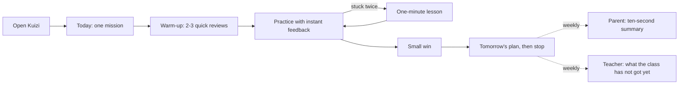

# Core journeys (design step 1: kickoff)

| | |
| --- | --- |
| Status | Draft for the product owner (design gate). Flows, not screens: the screens come in step 2, after the direction is chosen. |
| Date | 2026-10-24 |
| Author | Design / UX agent |
| Principles | Numbered as in [`01-vision.md`](01-vision.md): 1 safe and honest, 2 one next step, 3 calm, 4 effort you can see, 5 Arabic first, 6 parents in ten seconds, 7 grows up with the child and works on every phone |

**Notation.** `P` = parent screen, `C` = pupil screen, `T` = teacher screen. **Band A** = 11–12 (6e, most 7e); **band B** = 13–15 (8e, 9e). **[L1]–[L11]** mark the points where the legal answers (article 28 of Law 2004-63 and related questions in `minors-11-15.md` section 6) could change the flow; they are listed in section 7. All names are synthetic.

## 0. The loops at a glance

## 1. First run: parent first, then the child

**Who and when.** Samia, on her phone, one evening after the teacher's letter or a parents' Facebook post. 10–15 minutes for her part, then 10 minutes for Lina with her mother nearby. **Principles:** 1, 2, 6.

**Two doors.**

- **School code.** The teacher's letter (French and Arabic) carries a class code; the school confirms the parent–pupil link from its records. At launch this is **the only door for band A** (MR-C3). **[L3] [L7]**
- **Direct.** Parent's Tunisian mobile, a one-time code, a declaration of capacity, and a "this was not me" message 24 hours later (MR-C3). Band B only at launch.

### Parent part

| Step | Sees | Does | Feels | Kuizi does |
| --- | --- | --- | --- | --- |
| P01 Welcome | What Kuizi is, in three lines; what it is not (no ads, no ranking, no promise of admission); language switch العربية / Français | "Inscrire mon enfant" or "J'ai un code d'école" | Curious, wary of another app that wants money and data | Collects nothing yet |
| P02 Account | Phone number, then a 6-digit code | Types the code | Neutral | Verifies the phone. **[L5]** |
| P03 Who you are | "Vous êtes : le père (tuteur légal), la mère (garde), un autre tuteur désigné" | Chooses | Slightly formal; needs to be explained why | Records the capacity (MR-C2). If the person setting up is not the legal tutor: "Invite the other parent to confirm" by SMS link. **[L4]** |
| P04 Your child | First name or nickname, birth month and year, grade (6e–9e), school (pre-filled with a code) | Fills four fields | Fine: nothing intrusive (no photo, no ID number, MR-I3) | Derives band A or B. Band A on the direct door → "For 6e and 7e, Kuizi starts through schools for now" and an optional waiting list. **[L3]** |
| P05 The concours | "Lina passera-t-elle la Sixième en juin 2027 ? Oui / Pas encore décidé / Non". "Le concours est facultatif. Kuizi aide toute l'année ; ce choix change le plan à partir d'avril." All five subjects ticked | Chooses; may untick a subject (for example one already covered by a tutor) | Relief that it is optional | Sets the plan. Never asks for school marks |
| P06 What Kuizi keeps | The article 31 information in plain words: what is kept, why, who sees it, how long, the parent's rights. Short version first, full text one tap away | Reads, ticks "J'ai lu" | Reassured if short and honest | Sends the same text by SMS link or email as the written trace (MR-C8). **[L2]** |
| P07 Your choices | Separate switches: learning (required), AI tutor (off), reminders on the child's device (off), comfort and accommodations (off, opens its own flow), research (off) | Leaves defaults or switches some on | In control | Each refusable without losing the service (MR-C5, MR-T8). **[L8] [L9]** |
| P08 What happens next | A status line, for example "En attente : votre confirmation demain" or "En attente de l'autorisation légale, prévue vers le …", plus a 3-minute guide "Aider sans mettre la pression" | Reads the guide or closes | Possibly frustrated if the wait is long | **Processes no child data** until everything is recorded (MR-C1). Sends "Kuizi est prêt pour Lina" when the account is active. **[L1] [L2]** |
| P09 Hand over | "Donnez le téléphone à Lina. Restez à côté pendant dix minutes." (band A) / "Adam peut continuer seul." (band B) | Passes the phone | Curious to see the child's reaction | Switches to the pupil interface and language |

### Pupil part

| Step | Sees | Does | Feels | Kuizi does |
| --- | --- | --- | --- | --- |
| C01 Agreement | Band A: four picture cards with audio ("Kuizi t'aide à t'entraîner", "Tes réponses servent à choisir l'exercice suivant", "Pas de publicité", "Tu peux dire pas maintenant"). Band B: five short lines | "J'ai compris" or "Pas maintenant" (equal weight) | Respected | Records assent (MR-C6). "Pas maintenant" keeps the account waiting and tells the parent kindly. **[L6]** |
| C02 Make it yours | Preset avatars (no photo, MR-I4); "Lire les questions à voix haute"; text size | Picks an avatar | Ownership | Stores comfort settings, never a diagnosis (MR-A4) |
| C03 What your parents see | Two pictures: what parents see (progress, time), what they do not see | Taps "D'accord" | Trust | Same panel stays in the "Moi" tab (MR-F3) |
| C04 Warm-up intro | « Montre-moi ce que tu sais déjà. Environ 8 minutes. Ce n'est pas un contrôle : pas de note, et tu peux t'arrêter quand tu veux. » | "On y va" | Wary ("a test?"), then reassured | — |
| C05 Warm-up questions | One question per screen, mixed subjects, starting easy; no timer; no right or wrong colours; a visible **« Je ne sais pas encore »** answer; "5 sur environ 12" | Answers | Calm, if the first items are easy | Adaptive placement (IRT, T043, T175), stops early when sure. "Je ne sais pas encore" is a valid answer: it reduces guessing and fear |
| C06 Where we start | Three things already solid, named in plain words; the first mission; "Demain : …". No score, no level label | "Faire ma première mission (5 min)" or "Plus tard" | Proud ("I already know things") | The parent gets "Le point de départ de Lina" in plain words |
| C07 First mission | Five minutes, deliberately within reach | Practises | A first win | Ends on the session close (C17) |

**Screens:** P01–P09, C01–C07; states: waiting for activation, offline, wrong code, expired code.

## 2. The daily session: "20 minutes after dinner"

**Who and when.** Lina, Thursday 20:10, homework done, her mother's phone, not sure what to revise. Adam, 21:00, his own phone, after his private lesson. **Principles:** 2, 3, 4, 5, 7.

| Step | Sees | Does | Feels | Kuizi does |
| --- | --- | --- | --- | --- |
| Open | Band A: no push to the child by default; the parent may allow one in-app reminder a day (MR-N1). Band B: at most one reminder at the time he chose | Opens the app | "What do I have to do?" Wants it small | Tonight's mission is already prepared and downloaded for offline use |
| C10 Today | One mission: subject, notion, one sentence on why, three steps, about 15 min (band A) or 20–25 min (band B). "Commencer". "Une autre matière ce soir". The week's goal | Taps "Commencer" (the three-second test) | Knows what to do | Chooses the mission by concours weight and weakness (T057, T176) |
| C11 Warm-up | Two or three quick questions on notions already solid | Answers | Confident: an easy start | Spaced review (T054) |
| C12 Practice | One item per screen. Arabic text, maths left to right. Answer by tapping or the maths keypad (MR-D3); never drag-only (FR-A6). "Lis-moi" (read aloud) and "Aide" | Answers | Focused | Records the answer only (band A sends no hesitation data, MR-D2) |
| C13 Feedback | Right: a tick and one line of why ("3/4 = 9/12 et 2/3 = 8/12"). Not yet: « Pas encore. Regarde les dénominateurs. » Ink note, never red, icon plus words | Tries again or moves on | Not ashamed | Names the likely error (T071) |
| C14 Help | Band A: three guided buttons: "Je ne comprends pas la question", "Un indice", "Un exemple semblable"; a worked step after two tries (MR-T1, T070). Band B also: "Pose une question sur cet exercice" (300 characters, "Le tuteur est une IA"), only with the AI tutor consent | Picks a kind of help | Supported, not judged | No pupil text reaches an AI for band A. **[L8]** |
| **Stuck** → C15 One-minute lesson | After two misses on the same notion: « On regarde ça ensemble en une minute ? » Three or four interactive steps (cut two breads into thirds and quarters), no video | Manipulates, then answers a similar item | Frustration, then relief | Goes back to the prerequisite (T053, T179). If it works: « Tu l'as eu après la leçon. C'est comme ça qu'on apprend. » If not: « On y revient demain avec un autre exemple. » Nothing is reported to the parent as a failure |
| C16 Break | At 20 min (band A) or 25 min (band B): « Petite pause ? » "Continuer 5 minutes" and "M'arrêter là", equal weight | Chooses | Allowed to stop | Never interrupts an item (MR-N6) |
| C17 Small win | What was done tonight, in words: « 9 exercices. Comparer des fractions devient solide. Tu as utilisé un indice et tu as trouvé. » Tomorrow: « Éveil scientifique : les états de l'eau, 10 min ». **Primary: "Terminer pour ce soir"** | Closes | Proud, done | No "encore un", no autoplay (MR-S9). Updates the weekly goal |

**Branches:** C18 another subject (two suggestions for band A, any subject for band B); C19 "J'ai besoin d'aide" from any screen in at most two taps (MR-G2, NEW-9); C20 time to rest (the parent's daily limit or bedtime: progress saved, calm message, MR-N6); C21 offline (the mission continues from the cache, answers wait for the network).

**States for every screen:** loading (text placeholders, never a spinner longer than 1 s), empty (the first day: "Ta première mission arrive demain"), error ("Impossible de charger. Réessayer", with the offline mission as a fallback), success, offline.

**Screens:** C10–C21.

## 3. The concours run-up

**Who and when.** Lina for the Sixième (Monday 21 – Wednesday 23 June 2027, results Friday 9 July) and Adam for the Neuvième (Thursday 17 – Saturday 19 June 2027, results Monday 5 July). Dates from the Ministry calendar of 1 October 2026 (curriculum study, finding 2). **Principles:** 1, 3, 4, 6.

| Phase | Pupil sees | Parent sees | Kuizi does |
| --- | --- | --- | --- |
| **Switching on** (8 weeks before: Neuvième from Thursday 22 April, Sixième from Monday 26 April) | C30 "Ton plan pour la Sixième", weeks shown as steps: « Semaine 1 sur 8 ». What each week holds. **No day counter** (MR-S9) | P25 « Le plan de révision commence le lundi 26 avril : cinq matières, quatre soirs par semaine, un sujet d'entraînement le samedi matin (facultatif). » Band A: the parent switches it on. Band B: the pupil, with the parent's agreement | Weights review by the paper coefficients (Sixième: all five equal; Neuvième: Arabic, maths and SVT double, curriculum study 6.2) |
| **Weeks 1–6** | Missions mix weak notions and exam-format exercises. C31 practice paper in the official format and length; a timer appears **only here**, with "sans chrono" and extra-time options | "Sujet d'entraînement fait : ce qui a bien marché, ce qu'il faut revoir" | C32 review exercise by exercise. Band A: what went well, what to review. Band B: optionally a mark out of 20 for the paper (product owner question 5). Extra time needs the accommodation consent. **[L9]** |
| **Weeks 7–8** | Shorter sessions, no new notions, "ce que tu sais" summaries | "Semaines de consolidation : moins, mais régulier" | New content stops; spaced review tightens (T190) |
| **The last week** (Neuvième 10–16 June; Sixième 14–20 June) | C33 sessions of 10 minutes; the three-day timetable (day 1 Arabic and English, day 2 French and science, day 3 maths, as in 2026; to confirm for 2027); what to bring (convocation, pens, ruler, compass, water) | P22 « Comment l'accompagner cette semaine » : what helps, what to avoid saying | No extra reminders to band A (T159); band B at most one a day, none after 21:00 (FR-N7, MR-N2) |
| **The night before** (Neuvième: Wednesday 16 June; Sixième: Sunday 20 June) | C34 « Demain : arabe et anglais. Ce soir : dix minutes de révision légère, ou rien du tout. Les deux vont bien. » Primary: "Ma liste pour demain" (checklist). Secondary: "3 questions faciles pour me rassurer" (strong notions only). Then « Bonne nuit », and the app suggests closing | Nothing, unless the parent opens the app: one line on how to keep the evening calm | Quiet hours hold; no messages at all |
| **Between exam days** | C35 « Demain : français et éveil scientifique. Un petit rappel si tu veux. » No "how did it go?", no score entry | Nothing | Light review only |
| **After the last paper and on results day** | C36 « C'est fini. Bravo pour tout ce travail. » The plan pauses by itself | Nothing during the wait or on results day. A few days later: « Quel que soit le résultat, voici ce que Lina a appris cette année », and the bridge to 7e or to the 1ère année secondaire (French science vocabulary for Neuvième pupils) | Never asks for the result. No marketing in exam week or on results day (market study, 4.4) |

**Design rule replacing the countdown.** Pupils see "week 3 of 8" and the content of the week; the exam date appears on the parent's side and inside exam practice. A visible day count for band B is a product owner decision (question 4).

**Timing risk.** If activation takes weeks **[L1] [L2]**, a family that signs up in April misses the plan. P08 must say "Pour être prêt le 26 avril, inscrivez-vous avant le …", and sign-ups should open by the February mid-term break (1–7 February 2027).

**Screens:** P22, P25, C30–C36.

## 4. The parent's weekly view: ten seconds

**Who and when.** Samia, Sunday evening between shifts (she picks the day and time; parents keep their own quiet hours, FR-N8). **Principles:** 6, 1, 3.

| Step | Sees | Does | Feels | Kuizi does |
| --- | --- | --- | --- | --- |
| Message | SMS or email, no detail inside: « Kuizi : le résumé de la semaine de Lina est prêt. » and a link | Taps | "Let's see" | Sends nothing sensitive by SMS. **[L8]** |
| **P20 The ten seconds** (above the fold) | 1. « Lina a travaillé 4 soirs cette semaine, environ 1 h 10. » 2. **Plus solide :** comparer des fractions, le passé composé (filled shape + word). 3. **À travailler :** les problèmes de vitesse (outlined shape + word). 4. **Pour l'aider :** « À table, demandez-lui : comment sais-tu que 3/4 est plus grand que 2/3 ? » | Reads | Understands, knows one thing to do | No percentages, no rank, no "behind" (MR-S1, MR-P3). The summary is written by AI and judged before sending (T075) |
| P21 Detail (below the fold) | Each of the five subjects: notions as states (solide / en progrès / pas encore) with shapes and words; evenings worked, not timestamps; the concours plan from April | Scrolls if curious | Informed | — |
| P23 Controls, P24 Data | Daily limit, bedtime, reminders, quiet hours; consents, export, delete, withdraw; "Ce que voit Lina" | Adjusts | In control | Band A: the parent is the control centre (MR-F1) |

**Band B (Adam).** P20 shows effort (sessions, time) and subjects practised with an overall state; notion detail only if Adam chooses to share it. No item log, no tutor text (MR-F2). **[L11]**

**A quiet week.** « Lina n'a pas utilisé Kuizi cette semaine. Ça arrive. Si vous voulez, choisissez avec elle un soir fixe. » Never guilt.

**Screens:** P20–P24, plus the SMS and email templates.

## 5. The teacher's light loop

**Who and when.** Mme Rim, Monday 7:45, ten minutes, phone or the school laptop. Partner private school only (MR-E8). **Principles:** 2, 1.

| Step | Sees | Does | Kuizi does |
| --- | --- | --- | --- |
| T01 Set up (once) | Create "6e B"; a class code and a letter for parents (French and Arabic, PDF to share) | Shares the letter | Parents enrol and consent through the school door (MR-E2); the list fills as consents complete, first name and initial only (T224). **[L7] [L10]** |
| T02 This week in your class | Three notions most pupils have not got yet, as counts (« 17 élèves sur 24 : comparer des fractions »), each with a 10-minute class activity | "Donner comme série de la semaine" (one tap) | — |
| T04 Assign | The set and its due day | Confirms | Weaves the set into pupils' daily missions, so it adds no extra load at home |
| Friday on T02 | How many pupils did it (not when) and how the class moved on each notion | Reads | Never shows home-use timestamps (MR-E3) |
| T05 Before the mock exam | The class by subject: notions × states, as counts; no ranking. Opening one pupil shows their notion states, to prepare a parent meeting | Plans revision | Every opening of a pupil profile is audited (MR-E7) |
| T06 Class battle (later) | A teacher-run battle for the whole class, nicknames, no chat (the only duel allowed in band A, MR-S3) | Runs it in class | Live "struggling now" views exist only during a class session the teacher runs |

**Screens:** T01–T06.

## 6. Screens needed (summary)

| Journey | Screens | Count |
| --- | --- | --- |
| First run | P01–P09, C01–C07 | 16 |
| Daily session | C10–C21 | 12 |
| Concours run-up | C30–C36, P22, P25 | 9 |
| Parent weekly | P20, P21, P23, P24 (+ SMS and email templates) | 4 |
| Teacher | T01–T06 | 6 |
| **Total** | Each in Arabic and French, phone and desktop where relevant, with the five states | **47** |

Step 2 should design the first loop end to end before anything else: C10, C12–C15, C17, C19 and P20.

## 7. Where the legal answers could change the flow

| Flag | Open question (`minors-11-15.md`) | Where it hits | What could change | How the design absorbs it |
| --- | --- | --- | --- | --- |
| **L1** | How the family judge's authorisation (art. 28) works in practice (Q1) | P08, all activation | A wait of days or weeks, per child or per school | P08 is designed as a useful waiting room: honest status, an expected date, the parent guide. The child sees nothing until active (MR-C1) |
| **L2** | Must the art. 31 information arrive one month before processing? (Q6) | P06, P08, concours timing | Every activation delayed by a month | Notice sent at sign-up with "Kuizi ouvre le …"; sign-ups open by February for the April plan |
| **L3** | A direct method for band A without a school (MR-C3, Q24) | P01, P04 | 6e, the larger concours market, reachable only through schools at launch | School-code door first for band A; direct door and waiting list for band B |
| **L4** | Who the *tuteur* is; one parent or both; separated parents (Q4) | P03 | A second parent may have to confirm | "Invite the other parent" by SMS link; status shown on P08 |
| **L5** | Does a code by SMS plus a click count as "exprès et écrit"? (Q5) | P02, P06, P07 | An e-signature or a paper form through the school | Consent kept as its own step so its method can be swapped |
| **L6** | Weight of the child's refusal or withdrawal (Q7) | C01, the "Moi" tab | Band B refusal may block the account | "Pas maintenant" has equal weight; withdrawal from "Moi" tells the parent kindly (MR-C7) |
| **L7** | School or Ministry as controller (art. 53–54, Q2, Q3) | T01, the whole first run | The school, not the parent, may start the flow | The school-code door already exists; the parent part shrinks to consent and choices |
| **L8** | Transfers abroad (art. 52, Q9): AI tutor, SMS and email providers | C14, P07, P20 message | No AI tutor or no SMS at launch | Guided help works without AI (MR-T8); the summary lives in the app, the message only links to it |
| **L9** | Accommodations as health data (art. 14, 62–63, Q10) | P07, C31 extra time | Separate consent and restricted processing | Extra time and "sans chrono" sit behind their own consent; no diagnosis questions anywhere (MR-A4) |
| **L10** | Ministry authorisation for public schools (Q15) | T01 | No public schools at first | Partner private schools only (MR-E8) |
| **L11** | Parent's access right against the child's privacy (art. 32, Q17) | P20 for band B | The parent may be entitled to more detail | Detail sits behind a formal request, not in the weekly view |
