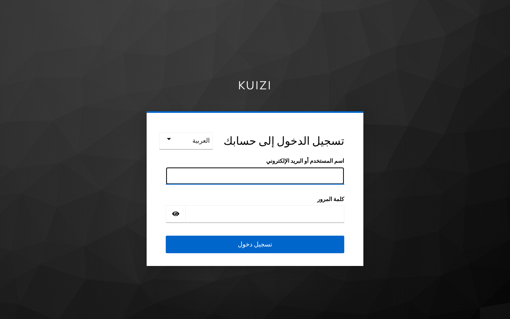
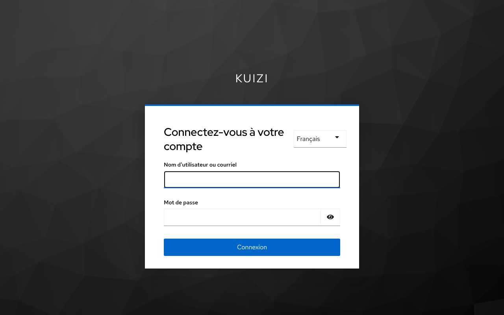
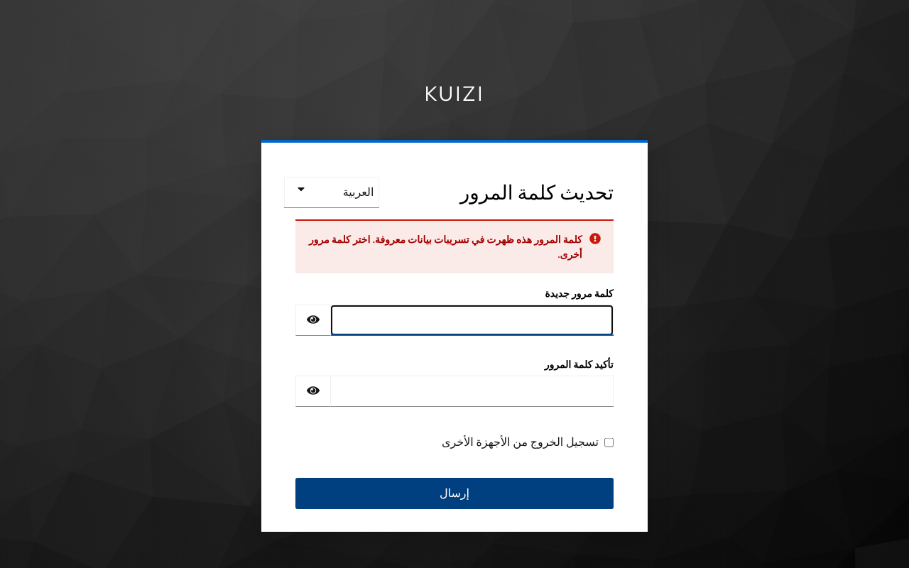
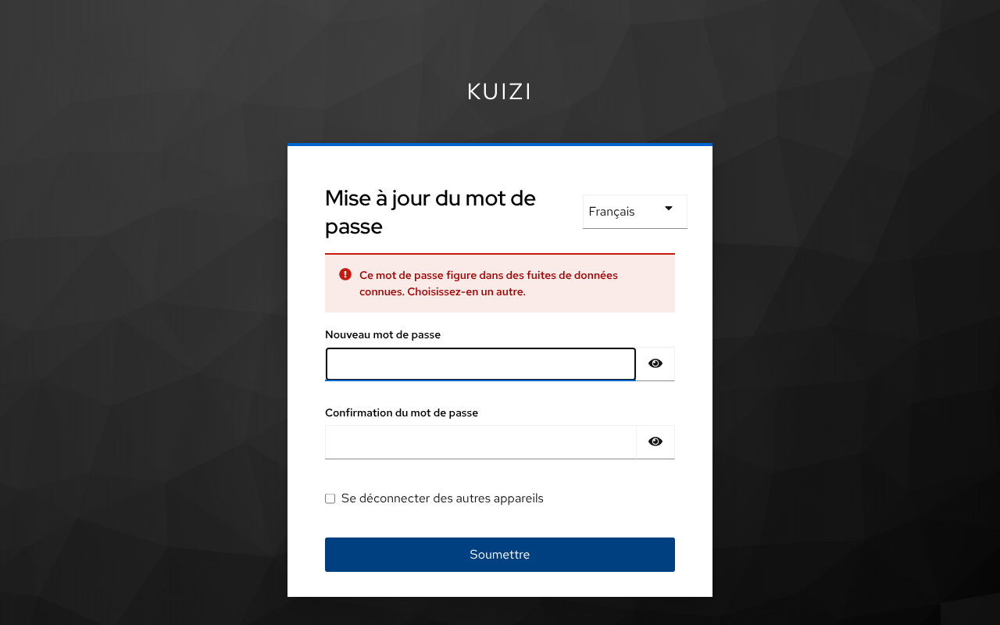
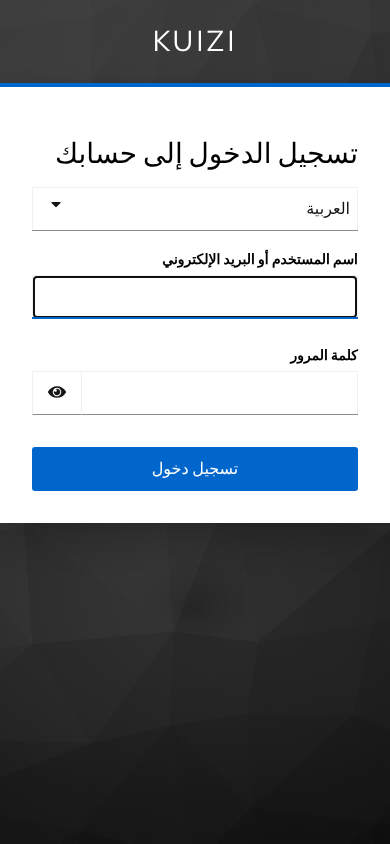

# Identity: Keycloak and token checks (T012)

Kuizi has **one identity provider, Keycloak, and one OIDC issuer**: the realm `kuizi`. Every app signs in there, every service accepts only access tokens from that realm, and every access token says who the user is (`sub`), which school or group they belong to (`tenant_id`) and what they may do (`roles`). Today this runs on the local stack ([ADR 0006](../architecture/decisions/0006-local-first-development.md)); Keycloak moves to EKS with high availability, and Kong starts checking tokens at the gateway, with the cloud move (T003, T005, T240). The design is recorded in [ADR 0009](../architecture/decisions/0009-identity-single-realm-and-keycloak-image.md).

| Piece | Where |
| --- | --- |
| Realm (roles, clients, token settings, password policy, Google) | [`infra/local/keycloak/kuizi-realm.json`](../../infra/local/keycloak/kuizi-realm.json) |
| Synthetic dev users (local only) | [`infra/local/keycloak/kuizi-users-0.json`](../../infra/local/keycloak/kuizi-users-0.json) |
| Kuizi Keycloak image: breached-password policy, login theme | [`services/keycloak/`](../../services/keycloak/README.md) |
| Token checks for TypeScript services | [`packages/auth/`](../../packages/auth/README.md) (`@kuizi/auth`) |

## One realm, not one per role

The ticket title speaks of "realms"; Kuizi uses **one realm with roles**, because:

- **One issuer.** Kong and every service trust one `iss` value and one key set (JWKS). With a realm per role, each service would need a list of issuers and key sets, and a mistake in that list would let the wrong population in.
- **People hold several roles.** A teacher can also be a parent; a school admin is often a teacher. In one realm that is one account with two roles; across realms it would be two accounts that cannot be linked.
- **Links between people.** Parent consent (T013) links a parent to a student; one realm keeps both in the same user store.
- **Schools are tenants, not realms.** The school a user belongs to is the `tenant_id` claim. Per-school sign-in with Microsoft 365 or Google Workspace (T094) is added later as identity brokering into the same realm.

## Roles

Realm roles, delivered in the top-level `roles` claim:

| Role | Who | Tenant |
| --- | --- | --- |
| `student` | Bac student, 17–19. Under-18 accounts do nothing before parental consent (T013) | their school, or `individual` |
| `parent` | Parent or guardian | their child's school, or `individual` |
| `teacher` | Teacher | their school |
| `school_admin` | School administrator | their school |
| `platform_admin` | Kuizi back-office staff | `platform` |
| `curriculum_author` | Writes and reviews items and the concept graph (kept from T237; not in the ticket's list) | `platform` |

Clients use `fullScopeAllowed: false` with a scope mapping to exactly these six roles, so Keycloak's own roles (`offline_access`, `default-roles-kuizi`…) never appear in tokens. What each role may do is decided by the authorisation middleware (T014), not here.

## Tenants

`tenant_id` is a user attribute, declared in the realm's user profile: **only admins (and later the onboarding services) can set it; users can neither see nor edit it.** Values match `^[a-z0-9][a-z0-9-]{0,62}$` (so UUIDs fit):

- a school's ID, assigned when the school is onboarded (T092, T095 decide the format);
- `individual`: students and parents who join without a school (new Google sign-ins land here);
- `platform`: Kuizi staff.

Row-level security (T092) sets `app.tenant_id` from this claim on every transaction.

## Clients

| Client | Type | Used by | Notes |
| --- | --- | --- | --- |
| `kuizi-web` | public, authorization code + PKCE S256 | Next.js app and portals (T076) | Redirect `http://localhost:3000/*`; a sign-in without PKCE is refused |
| `kuizi-mobile` | public, authorization code + PKCE S256 | iOS and Android apps (T163, T164) | Redirect `tn.kuizi.app:/oauth2redirect` (placeholder until the bundle ID and domain are chosen, T162, T212); may ask for `offline_access` |
| `kuizi-api` | bearer-only | Kuizi services | Never signs anyone in; it is the audience (`aud`) of every access token |
| `kuizi-dev-cli` | public, password grant | Integration tests and `make smoke` | **Local only.** Never create it outside the local stack |

All three sign-in clients carry the same four protocol mappers (`sub`, `tenant_id`, `roles`, audience `kuizi-api`); a new client copies them from `kuizi-web`.

## Tokens

An access token for `dev-student` signed in through the web app:

```json
{
  "iss": "http://localhost:8080/realms/kuizi",
  "aud": "kuizi-api",
  "sub": "f41e3b5c-b3e8-484d-8d70-a5405d99b689",
  "typ": "Bearer",
  "azp": "kuizi-web",
  "sid": "Zz4Jwbds0bIuUQi8NoXJfRfd",
  "jti": "onltro:8b744b10-1de5-6b26-5c69-099326bfd985",
  "scope": "openid email profile",
  "tenant_id": "demo-school-a",
  "roles": ["student"],
  "iat": 1792359397,
  "exp": 1792360297
}
```

- **No name, email or username in access tokens.** Clients use Keycloak's *lightweight access token*, so tokens that travel to every service (and may end up in gateway logs) carry no personal data beyond the user ID. The ID token, read only by the app that signed in, carries the name and email (and the locale once set) for display, plus `tenant_id` and `roles`.
- Signed RS256 with the realm key; Keycloak publishes the public keys at `/realms/kuizi/protocol/openid-connect/certs`.
- `sid` and `jti` are opaque strings: their format changed between Keycloak 26.1 and 26.8 (UUIDs before), so code must not parse them.

| Setting | Value | Why |
| --- | --- | --- |
| Access token | **15 minutes** | Ticket requirement; a leaked token is useful for 15 minutes at most |
| Refresh token | **rotates on every use; a used one is refused** (`revokeRefreshToken`, reuse 0) | A stolen refresh token stops working as soon as the real app refreshes |
| SSO session | idle 30 minutes, at most 10 hours (Keycloak defaults) | An open app refreshes every 15 minutes, which keeps the session alive |
| Offline session (mobile, `offline_access`) | idle 30 days, at most 60 days | Students stay signed in on their phone without a forever token |

These durations are proposals for the product owner to confirm (see the hand-back questions).

## Signing in

### Email and password, in French and Arabic

The login page offers exactly French (default) and Arabic. Arabic renders right to left (`<html lang="ar" dir="rtl">`, mirrored layout). The realm uses the small **Kuizi login theme**, Keycloak's `keycloak.v2` theme plus CSS that makes every button, field, menu and checkbox row at least 44 px high (Keycloak's own controls are 36 px), and a correction to Keycloak's Arabic title for the password-change page. Branding (Cyanotype tokens, logo) comes with T231 and T174.

| Arabic | French |
| --- | --- |
|  |  |
|  |  |

Arabic on a phone (390 px wide): 

Screenshots taken with Playwright (Chromium) against the local stack (Keycloak 26.8.1) on 2026-10-18; every control measured 44 px high or more (Keycloak's own theme draws them 36 px high).

Self-registration is **off** until the consent flow exists (T013): accounts are created by admins, by Google sign-in, or later by Kuizi's own onboarding. Password reset by email and email verification are off locally because the local stack has no mail server; they come with SES (T212).

### Password policy

`length(12) and maxLength(128) and notUsername and notEmail and pwnedPassword(1)`

- At least 12 characters, at most 128, not the username, not the email. No forced mix of character classes and no periodic change (NIST SP 800-63B): length and the breach check do more for security.
- **`pwnedPassword(1)`** refuses a password that appears at least once in [Have I Been Pwned](https://haveibeenpwned.com/Passwords). It uses the k-anonymity range API: Keycloak hashes the password with SHA-1 and sends only the **first 5 hex characters** to `https://api.pwnedpasswords.com/range/<prefix>`, with response padding; the comparison with the rest of the hash happens inside Keycloak. Neither the password nor its hash leaves the server, and nothing about it is logged. Example: `Password1234!` (34,273 breaches) is refused with "Ce mot de passe figure dans des fuites de données connues. Choisissez-en un autre." / "كلمة المرور هذه ظهرت في تسريبات بيانات معروفة. اختر كلمة مرور أخرى."
- If the API cannot be reached (offline PC, outage), the check **fails open**: the password is judged on the other rules and Keycloak logs `Pwned-password check unavailable`. Set `KC_SPI_PASSWORD_POLICY_PWNED_PASSWORD_FAIL_CLOSED=true` to refuse instead. Details and settings: [`services/keycloak/README.md`](../../services/keycloak/README.md).
- Passwords are stored with Argon2 (Keycloak's default).

### Brute-force protection

After 5 failed sign-ins the account is locked for 1 minute; every further 5 failures add a minute, up to 15 minutes; the failure count resets after 12 hours. Two failures less than a second apart also cost a 1-minute wait. Lockouts are never permanent, so nobody can lock a student out for good, and the error message stays "invalid username or password" so it does not reveal that the account exists.

### Google, for students

The `google` identity provider is configured but **off**. Its client ID and secret come from `KEYCLOAK_GOOGLE_CLIENT_ID` and `KEYCLOAK_GOOGLE_CLIENT_SECRET` (`.env.example`, empty by default), which Keycloak reads when it imports the realm. New accounts created through Google get the `student` role and the `individual` tenant; existing accounts with the same email are linked after the user proves they own them. To try it locally:

1. Create an OAuth client (type *Web application*) in a Google Cloud project, with redirect URI `http://localhost:8080/realms/kuizi/broker/google/endpoint`. A Google Cloud project is a new vendor account: the product owner decides.
2. Put the ID and secret in `.env`, re-import the realm (below), then switch the provider on in the admin console (*Identity providers → google → Enabled*).

Sign in with Apple, required on iOS wherever Google is offered, comes with T166.

### Phone OTP for parents (designed, not built)

The ticket asks for phone sign-in for parents; it is not an acceptance criterion and needs decisions first. How it fits:

1. **Phone number attribute.** `phone_number` (E.164, `+216…`) and `phone_number_verified` in the user profile. This is a new personal-data field: the product owner and the DPO approve it first.
2. **SMS OTP authenticator.** A Keycloak authenticator provider next to the password policy in `services/keycloak/providers/`: 6-digit code, valid 5 minutes, single use, 3 attempts, rate-limited per number and per IP; the code lives hashed in the authentication session, never in logs. It asks the delivery service (T089, behind the Notification Orchestrator T152 as an *essential* message, so quiet hours and budgets never block it) to send the SMS through the Tunisian gateway T089 chooses.
3. **Parent sign-in flow.** A browser flow where the parent types a phone number, then the code; password optional.
4. **Consent (T013).** The student enters a parent's phone or email; the parent receives a code, signs in with it and gives consent; the consent service records it and activates the student. Because access tokens live 15 minutes and a revoked consent must freeze the student within 1 minute, T013 also needs a revocation check in services (for example a short-lived "frozen subjects" list in Redis, checked by `@kuizi/auth`), not just a Keycloak role change.
5. **Locally,** a fake SMS sender that shows codes in a local outbox, never in a real SMS.

Deferred until: an SMS provider is chosen (vendor and cost, T089), the phone attribute is approved, and T013 designs the consent flow.

## Dev users (local only)

Synthetic accounts, imported with the realm. Passwords are `<username>-local-only`; emails use the reserved `.test` domain.

| Username | Role | Tenant |
| --- | --- | --- |
| `dev-student` | student | `demo-school-a` |
| `dev-parent` | parent | `demo-school-a` |
| `dev-teacher` | teacher | `demo-school-a` |
| `dev-teacher-b` | teacher | `demo-school-b` (second school, for tenant-isolation tests: T014, T092) |
| `dev-school-admin` | school_admin | `demo-school-a` |
| `dev-platform-admin` | platform_admin | `platform` |
| `dev-curriculum-author` | curriculum_author | `platform` |

## Try it locally

```bash
make up                      # the first run also builds the Kuizi Keycloak image (about 2 minutes)
make smoke                   # includes a dev-user token check and the Arabic page check

# A token for dev-teacher, through the local-only client
curl -s -d client_id=kuizi-dev-cli -d grant_type=password -d scope=openid \
  -d username=dev-teacher -d password=dev-teacher-local-only \
  http://localhost:8080/realms/kuizi/protocol/openid-connect/token | python3 -m json.tool

```

The login page in Arabic, in a browser (the web app adds `ui_locales=ar` to its sign-in request): http://localhost:8080/realms/kuizi/protocol/openid-connect/auth?client_id=kuizi-web&response_type=code&scope=openid&redirect_uri=http%3A%2F%2Flocalhost%3A3000%2Fcallback&code_challenge=E9Melhoa2OwvFrEMTJguCHaoeK1t8URWbuGJSstw-cM&code_challenge_method=S256&ui_locales=ar

Admin console: http://localhost:8080/admin (user `admin`, password `KEYCLOAK_ADMIN_PASSWORD` in `.env`), realm **kuizi**.

### Applying a change to the realm file

Keycloak imports `infra/local/keycloak/*.json` only when the realm does not exist yet. After editing the realm or the dev users, delete the realm and recreate the Keycloak container (other services keep running and keep their data):

```bash
. ./.env
TOKEN=$(curl -s -d client_id=admin-cli -d grant_type=password -d username="$KEYCLOAK_ADMIN" \
  -d password="$KEYCLOAK_ADMIN_PASSWORD" "$KEYCLOAK_URL/realms/master/protocol/openid-connect/token" |
  python3 -c 'import sys, json; print(json.load(sys.stdin)["access_token"])')
curl -s -X DELETE -H "Authorization: Bearer $TOKEN" "$KEYCLOAK_URL/admin/realms/$KEYCLOAK_REALM"
docker compose -f infra/local/compose.yaml --env-file .env up -d --force-recreate --wait keycloak
```

`make reset` also works but deletes every service's data. After a change in `services/keycloak/`, bump the image tag in `infra/local/compose.yaml` (or run `docker compose -f infra/local/compose.yaml --env-file .env build keycloak`) so the image is rebuilt.

Keycloak upgrades are one-way: on start, a newer Keycloak migrates its database (for example 26.1 to 26.8), and an older image then refuses to start on it. Going back to an older Keycloak means `make reset`, or dropping and recreating only the `keycloak` database.

Stock Keycloak (without the Kuizi image) cannot load this realm: it does not know the `pwnedPassword` policy and answers HTTP 500 for every `kuizi` page, including the admin call that would delete the realm. Before going back to a checkout older than T012, delete the realm with the commands above while the Kuizi image still runs, or use `make reset`.

## How services check tokens

Every TypeScript service uses `@kuizi/auth` ([README](../../packages/auth/README.md)):

```ts
import { bearerToken, createTokenVerifier, verifierConfigFromEnv, wwwAuthenticate } from "@kuizi/auth";

const verifier = createTokenVerifier(verifierConfigFromEnv()); // KEYCLOAK_URL, KEYCLOAK_REALM, KEYCLOAK_API_AUDIENCE

const principal = await verifier.verify(bearerToken(request.headers.authorization));
// principal.subject, principal.tenantId, principal.roles
// On failure: TokenVerificationError with .code, .status (401 or 503); answer with wwwAuthenticate(error).
```

It checks, in order: token present and under 8 KB; RS256 signature against the realm JWKS (fetched once, cached 10 minutes, refetched for an unknown key ID, so key rotation needs no restart); `iss`; `aud` contains `kuizi-api`; `exp`, `nbf`, `iat` with 5 seconds of clock skew; `typ` is `Bearer` (ID tokens are refused); lifetime at most 15 minutes; `sub` present; `tenant_id` present and well formed; at least one Kuizi role. Error messages never contain the token or claim values, so they are safe to log. Services check tokens themselves even behind Kong: a request that reaches a service without passing the gateway is still refused.

## Kong, later (T005)

Kong arrives with the cloud. The same checks at the gateway, as a draft for T005 to confirm against the Kong edition it picks:

- **Kong Enterprise or Konnect** (`openid-connect` plugin), on every `/api/v1/*` route:

  ```yaml
  plugins:
    - name: openid-connect
      config:
        issuer: https://<keycloak-host>/realms/kuizi/.well-known/openid-configuration
        auth_methods: [bearer]
        bearer_token_param_type: [header]
        audience_required: [kuizi-api]
        roles_claim: [roles]
        roles_required: [student, parent, teacher, school_admin, platform_admin, curriculum_author] # any one
        leeway: 5
        upstream_headers_claims: [sub, tenant_id]
        upstream_headers_names: [x-kuizi-user, x-kuizi-tenant]
  ```

  A missing `tenant_id` then shows as a missing `x-kuizi-tenant` header; a `pre-function` step answers 401 when it is absent, and the gateway must strip any `x-kuizi-*` header sent by clients.
- **Kong Gateway open source** (`jwt` plugin): a consumer whose JWT credential has `key` = the realm issuer, `algorithm: RS256` and the realm public key; plugin config `key_claim_name: iss`, `claims_to_verify: [exp]`, `maximum_expiration: 900`. This plugin checks neither `aud` nor custom claims and does not follow key rotation, so `aud`, `tenant_id` and `roles` need a small custom plugin; services keep checking them with `@kuizi/auth` either way.

## In the cloud (T240)

- Keycloak on EKS with at least two replicas sharing sessions (Infinispan), Aurora PostgreSQL, the same Kuizi image built with an optimised `kc.sh build` stage, TLS at the ingress and `sslRequired: all`.
- The cloud realm keeps roles, clients, mappers, token settings, password policy, theme and Google, and drops `kuizi-dev-cli` and the dev users. Redirect URIs use the real domain (T212).
- Secrets (Google client secret, admin password) come from AWS Secrets Manager (T016), not `.env`.
- Login and admin events and their retention are decided with the audit log (T022) and the data lifecycle (T018); they stay off locally.

## Personal data held by Keycloak

Username, email, first and last name, `tenant_id`, an Argon2 password hash, and session data (IP address, browser) while a session lives. No date of birth, phone number or accommodation data. Adding any personal field (phone for parents, date of birth to know who is under 18) needs the product owner and the DPO (Law 2004-63, minors' data).

## Tests

```bash
pnpm --filter @kuizi/auth test     # unit tests, plus integration tests when Keycloak is running
make smoke                         # stack-wide checks, including two Keycloak identity checks
cd services/keycloak/providers/pwned-password-policy && mvn -B package   # provider unit tests (or docker build)
```

The integration tests (`packages/auth/test/*.integration.test.ts`) get real tokens for every dev user and check the claims, the 15-minute lifetime, refresh-token rotation, the Arabic and French login pages, PKCE, the password policy (the breach check runs only when the internet is reachable), brute-force lockout and the Google provider being off. They skip themselves when Keycloak is not running.
